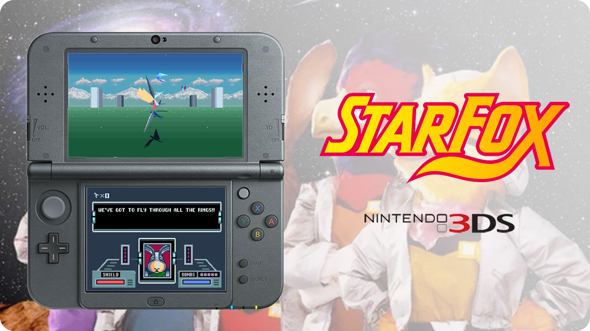

> [!WARNING]
> This is an experimental release.
>
> HOME may freeze the console. I am aware and working on a fix.

<h1 align="center">Starwing 3DS</h1>

<p align="center">
  <strong>Set course for Lylat. Take the squadron with you.</strong><br>
  Star Fox / Starwing, adapted for Nintendo 3DS.
</p>

<p align="center">
  <a href="#download-and-installation">Download</a> ·
  <a href="#features">Features</a> ·
  <a href="#documentation">Documentation</a> ·
  <a href="docs/CHANGELOG.md">Changelog</a> ·
  <a href="docs/CONTRIBUTING.md">Contribute</a> ·
  <a href="#community-and-bug-reports">Community</a>
</p>

<p align="center">
  <a href="https://github.com/EstebanPdN/starwing-3ds/releases/tag/v1.2-E2"></a>
  <a href="docs/COMPATIBILITY.md"></a>
  <a href="docs/UPDATING.md"></a>
  <a href="docs/legal/THIRD_PARTY_NOTICES.md"></a>
</p>

<p align="center">
  
</p>

<p align="center">
  <a href="https://estebanpdn.github.io/"></a>
  <a href="https://discord.gg/BjbzfRYpV"></a>
</p>

A Nintendo 3DS adaptation of the SNES **Star Fox / Starwing**, based on
KandoWontU's Starfox Enhanced, UltraStarFox, and Team SFEX's work.

This project was developed with the help of [OpenAI Codex](https://openai.com/codex/) and [Claude Code](https://claude.com/product/claude-code). Learn more about the development process [here](AI_DEVELOPMENT.md).

**This is an early release.** The port is expected to be
completable, but extensive playtesting is still pending. See
[Compatibility](docs/COMPATIBILITY.md) for the current scope.

## Features

<table>
  <tr>
    <td width="50%" valign="top"><strong>Take flight</strong><br>Play the Original experience, with wide presentation and optional top HUD. Star Fox EX and stereoscopic depth are experimental.</td>
    <td width="50%" valign="top"><strong>Made for two screens</strong><br>Native 400×240 upper presentation, a separate 320×240 touch interface, Circle Pad and D-pad controls.</td>
  </tr>
  <tr>
    <td width="50%" valign="top"><strong>Pick up and play</strong><br>Native SPC audio, volume settings, persistent options, per-ROM EX SRAM and optional checkpoints.</td>
    <td width="50%" valign="top"><strong>Keep it current</strong><br>Built-in Stable and Experimental updates, release notes, verified downloads and local diagnostics.</td>
  </tr>
</table>

Original game speed, interpolation ON and a 60 FPS presentation limit are the
defaults. Existing saved preferences are preserved. The limit is not a claim
of sustained hardware FPS. Star Fox EX is not fully supported.

## Download and installation

<p>
  <a href="https://github.com/EstebanPdN/starwing-3ds/releases/download/v1.2-E2/Starwing-3DS.cia"></a>
  <a href="https://github.com/EstebanPdN/starwing-3ds/releases/download/v1.2-E2/Starwing-3DS.3dsx"></a>
</p>

**Supported systems: New Nintendo 3DS / New 2DS XL and Old Nintendo 3DS / 2DS.**
Old 3DS / 2DS support is new in 1.2 and experimental: busy scenes can show
fewer frames than on New models. See [Compatibility](docs/COMPATIBILITY.md).

[Release notes and FBI QR](https://github.com/EstebanPdN/starwing-3ds/releases/tag/v1.2-E2) · [Project website](https://estebanpdn.github.io/star-fox.html)

1. Install `Starwing-3DS.cia` with FBI, or scan the release's QR in
   **Remote Install → Scan QR Code**.
2. Place your compatible, clean `.sfc` or `.smc` ROM in `/3ds/Starwing/` on SD.
3. Launch Starwing. The game validates your ROM and builds its companion locally.
4. Use **Options → Game Version** for Original / EX and **ROM Files** to select
   another ROM. Keep your existing SD data when upgrading.

The 3DSX is also available for Homebrew Launcher. A compatible user-supplied
ROM is required; no ROM download is provided. Supported revisions, upgrade
behavior, settings, and files are covered in [SD data](docs/SD-DATA.md).

The built-in **Options → Update** checks this repository for future releases.
See [Updating](docs/UPDATING.md) for installation and recovery.

## Controls

| Input | Action |
| --- | --- |
| Circle Pad / D-pad | SNES movement; D-pad takes priority. |
| A / B / X / Y, L / R | Corresponding SNES buttons; the chosen in-game control scheme assigns their actions. |
| START / SELECT | SNES controls, subject to enabled diagnostic shortcuts. |
| Touch screen | Options, game selection, and diagnostic cards. |
| 3D slider | Experimental depth in eligible wide Mode 2 gameplay and training. |

## Documentation

- [Repository map and maintenance conventions](docs/REPOSITORY.md)


| Guide | Purpose |
| --- | --- |
| [Compatibility and current status](docs/COMPATIBILITY.md) | Supported inputs, implemented paths, and validation limits. |
| [Built-in updater](docs/UPDATING.md) | Check, verify, install, and recover future updates. |
| [SD data and configuration](docs/SD-DATA.md) | Files, defaults, checkpoints, recovery, and upgrades. |
| [Diagnostics](docs/DIAGNOSTICS.md) | Captures, memory errors, timing fields, and private reporting. |
| [Building](docs/BUILDING.md) | Pinned toolchain, private inputs, 3DSX, and CIA packaging. |
| [Architecture](docs/ARCHITECTURE.md) | Runtime flow, module boundaries, ownership, threads, and caches. |
| [Testing](docs/TESTING.md) | ROM-free checks, target checks, and the evidence ladder. |
| [Verification status](docs/STATUS.md) | What was checked for the current source and package. |
| [Source provenance](docs/UPSTREAM.md) | Upstream revisions and publication boundaries. |

## Development

Requirements for the ROM-free checks: Python 3, Bash, a C++20 compiler, pkg-config, and Jansson development headers.

```sh
git clone https://github.com/EstebanPdN/starwing-3ds.git
cd starwing-3ds
python3 tools/check-publication.py
bash tools/test-host.sh
```

A full game build additionally needs devkitPro and the locally prepared inputs
in the [build guide](docs/BUILDING.md). The clean source checkout alone does
not generate a playable package. See [Contributing](docs/CONTRIBUTING.md) before
changing timing, rendering, data formats, or the platform boundary.

## Community and bug reports

[Join the project Discord](https://discord.gg/BjbzfRYpV) for updates, testing,
suggestions, and support. Use [GitHub issues](https://github.com/EstebanPdN/starwing-3ds/issues)
for reproducible reports. Capture shortcuts and sharing precautions are in
[Diagnostics](docs/DIAGNOSTICS.md).

## Credits

- KandoWontU, UltraStarFox, and Team SFEX — engine, reconstruction, EX, research,
  tools, and upstream work; individual credits are in [CREDITS.md](docs/legal/CREDITS.md).
- Nintendo and Argonaut Software — the original Star Fox / Starwing.
- devkitPro contributors — devkitARM, libctru, Citro3D, and Citro2D.
- Esteban PDN — Nintendo 3DS adaptation and repository maintenance, with help from Codex.
- Snipy44300 — ALttP Community Patches optimization reference.

## License and legal notice

[LICENSE-XBRZ.txt](docs/legal/LICENSE-XBRZ.txt) contains **GNU GPL v3.0** for the xBRZ
component. GitHub's automatic license label refers to this detected license;
it is not a blanket license for every file or for the game content.

Third-party components retain their own licenses and notices. See
[THIRD_PARTY_NOTICES.md](docs/legal/THIRD_PARTY_NOTICES.md) and the vendored
[Citro2D license](platform/3ds/vendor/citro2d/LICENSE). No blanket MIT or GPL
license is assigned to the whole project. The native engine is republished with permission confirmed by the repository
maintainer. Its inspected checkout has no general root license; this permission
does not assign a new blanket license or extend to Nintendo game data.

Nintendo owns Star Fox / Starwing and its game content. This is an unofficial
fan project and is not affiliated with or endorsed by Nintendo. The showcase
image is illustrative project artwork; it does not license the depicted game
or trademark assets for redistribution.

---

<p align="center">
  <a href="https://estebanpdn.github.io/">Esteban’s Forge</a> ·
  <a href="https://discord.gg/BjbzfRYpV">Discord</a> ·
  <a href="docs/legal/CREDITS.md">Credits</a> ·
  <a href="docs/legal/THIRD_PARTY_NOTICES.md">Third-party notices</a><br>
  <sub>Star Fox / Starwing belongs to Nintendo. This is an independent fan project.</sub>
</p>
