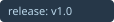
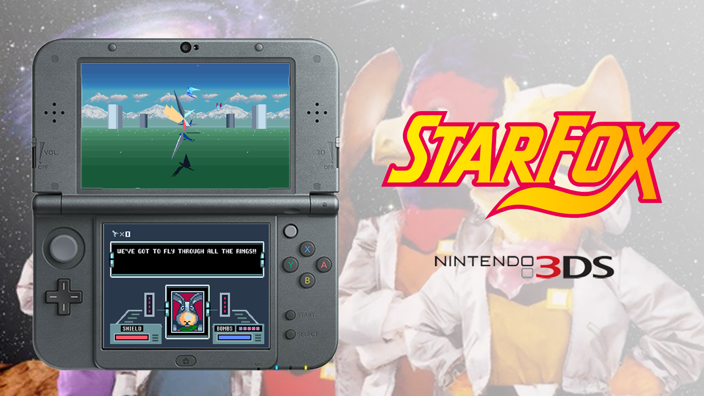

<h1 align="center">Starwing 3DS</h1>
<p align="center">Star Fox / Starwing, adapted for Nintendo 3DS.</p>
<p align="center">
  <a href="https://github.com/EstebanPdN/starwing-3ds/releases/tag/v1.0">Download v1.0</a> ·
  <a href="#features">Features</a> ·
  <a href="#documentation">Documentation</a> ·
  <a href="CHANGELOG.md">Changelog</a> ·
  <a href="CONTRIBUTING.md">Contribute</a>
</p>

<p align="center">
  <a href="https://github.com/EstebanPdN/starwing-3ds/releases/tag/v1.0"></a>
  <a href="docs/COMPATIBILITY.md"></a>
  <a href="THIRD_PARTY_NOTICES.md"></a>
</p>



A Nintendo 3DS adaptation of the SNES **Star Fox / Starwing**, based on
KandoWontU's Starfox Enhanced, UltraStarFox, and Team SFEX's work. Made with
help from Codex. **v1.0 is the first public release.** Performance and hardware
coverage are described in [Compatibility](docs/COMPATIBILITY.md).

## Features

| Play | Nintendo 3DS integration |
| --- | --- |
| Original Star Fox and an experimental Star Fox EX selection. | Native 400×240 upper presentation and a separate 320×240 touch interface. |
| Circle Pad and D-pad movement with SNES button mapping. | Native SPC audio, volume settings, and persistent options. |
| Wide presentation, optional top HUD, and experimental stereoscopic depth. | Per-ROM EX SRAM, optional checkpoints, and local diagnostics. |

The simulation targets 20 source ticks per second; presentation targets 60
frames per second. These are scheduling targets, not a sustained hardware FPS
claim. Star Fox EX is not fully supported.

## Download and installation

[**Download Starwing 3DS v1.0**](https://github.com/EstebanPdN/starwing-3ds/releases/tag/v1.0)

1. Install `Starwing-3DS.cia` with FBI, or scan the release's QR in
   **Remote Install → Scan QR Code**.
2. Place your compatible, clean `.sfc` or `.smc` ROM in `/3ds/Starwing/` on SD.
3. Launch Starwing. The game validates your ROM and builds its companion locally.
4. Use **Options → Game Version** for Original / EX and **ROM Files** to select
   another ROM. Keep your existing SD data when upgrading.

The 3DSX is also available for Homebrew Launcher. A compatible user-supplied
ROM is required; no ROM download is provided. Supported revisions, upgrade
behavior, settings, and files are covered in [SD data](docs/SD-DATA.md).

The built-in **Options → Update** checks this repository for future releases.
See [Updating](docs/UPDATING.md) for installation and recovery.

## Controls

| Input | Action |
| --- | --- |
| Circle Pad / D-pad | SNES movement; D-pad takes priority. |
| A / B / X / Y, L / R | Corresponding SNES buttons; the chosen in-game control scheme assigns their actions. |
| START / SELECT | SNES controls, subject to enabled diagnostic shortcuts. |
| Touch screen | Options, game selection, and diagnostic cards. |
| 3D slider | Experimental depth in eligible wide Mode 2 gameplay and training. |

## Documentation

| Guide | Purpose |
| --- | --- |
| [Compatibility and current status](docs/COMPATIBILITY.md) | Supported inputs, implemented paths, and validation limits. |
| [Built-in updater](docs/UPDATING.md) | Check, verify, install, and recover future updates. |
| [SD data and configuration](docs/SD-DATA.md) | Files, defaults, checkpoints, recovery, and upgrades. |
| [Diagnostics](docs/DIAGNOSTICS.md) | Captures, memory errors, timing fields, and private reporting. |
| [Building](docs/BUILDING.md) | Pinned toolchain, private inputs, 3DSX, and CIA packaging. |
| [Architecture](docs/ARCHITECTURE.md) | Runtime flow, module boundaries, ownership, threads, and caches. |
| [Testing](docs/TESTING.md) | ROM-free checks, target checks, and the evidence ladder. |
| [Verification status](docs/STATUS.md) | What was checked for the current source and package. |
| [Source provenance](docs/UPSTREAM.md) | Upstream revisions and publication boundaries. |

## Development

Requirements for the ROM-free checks: Python 3, Bash, a C++20 compiler, pkg-config, and Jansson development headers.

```sh
git clone https://github.com/EstebanPdN/starwing-3ds.git
cd starwing-3ds
python3 tools/check-publication.py
bash tools/test-host.sh
```

A full game build additionally needs devkitPro and the locally prepared inputs
in the [build guide](docs/BUILDING.md). The clean source checkout alone does
not generate a playable package. See [Contributing](CONTRIBUTING.md) before
changing timing, rendering, data formats, or the platform boundary.

## Community

[Join the project Discord](https://discord.gg/zy8BqH5ss) for updates, testing,
suggestions, and support. Use [GitHub issues](https://github.com/EstebanPdN/starwing-3ds/issues)
for reproducible reports. Capture shortcuts and sharing precautions are in
[Diagnostics](docs/DIAGNOSTICS.md).

## Credits

- KandoWontU, UltraStarFox, and Team SFEX — engine, reconstruction, EX, research,
  tools, and upstream work; individual credits are in [CREDITS.md](CREDITS.md).
- Nintendo and Argonaut Software — the original Star Fox / Starwing.
- devkitPro contributors — devkitARM, libctru, Citro3D, and Citro2D.
- Esteban PDN — Nintendo 3DS adaptation and repository maintenance.

## License and legal notice

[LICENSE-XBRZ.txt](LICENSE-XBRZ.txt) contains **GNU GPL v3.0** for the xBRZ
component. GitHub's automatic license label refers to this detected license;
it is not a blanket license for every file or for the game content.


Third-party components retain their own licenses and notices. See
[THIRD_PARTY_NOTICES.md](THIRD_PARTY_NOTICES.md) and the vendored
[Citro2D license](platform/3ds/vendor/citro2d/LICENSE). No blanket MIT or GPL
license is assigned to the whole project. The native engine is republished with permission confirmed by the repository
maintainer. Its inspected checkout has no general root license; this permission
does not assign a new blanket license or extend to Nintendo game data.

Nintendo owns Star Fox / Starwing and its game content. This is an unofficial
fan project and is not affiliated with or endorsed by Nintendo. The showcase
image is illustrative project artwork; it does not license the depicted game
or trademark assets for redistribution.
