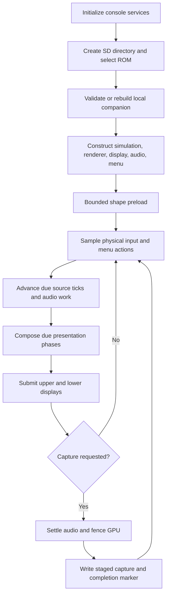

# Architecture

Starwing 3DS keeps the native Starfox Enhanced engine and places the console
adapter under `platform/3ds/`. This is a SNES Star Fox / Starwing adaptation.
This branch maintains the 3DS adapter and its shared engine/host verification
tools. Independent desktop and other-console application shells have been
retired; shared engine dependencies retain their source and attribution.

## Source map

| Path | Responsibility |
| --- | --- |
| `include/starfox/` | Engine interfaces: assets, simulation, rendering, audio, input, timing, and state. |
| `src/assets/` | Validated ROM, BPS, shape, symbol, and runtime-companion decoding. |
| `src/simulation/` | Source game flow, objects, strategies, collision, map VM, and remaining 65C816 boundaries. |
| `src/render/` | Indexed rasterization, SNES background/sprite decoding, palettes, and model drawing. |
| `src/audio/` | SPC state and audio processing. |
| `platform/3ds/source/` | Console services, presentation, input, menu, storage, and diagnostics. |
| `platform/3ds/vendor/citro2d/` | Attributed Citro2D fork with scoped cache-flush changes. |
| `tests/` | Portable, synthetic, and data-dependent regression checks. |
| `tools/` | Builders, validators, source preparation, and development utilities. |

## Console modules

| Module | Owns | Boundary |
| --- | --- | --- |
| `game_3ds.cpp` | Session orchestration, source ticks, presentation phases, menu actions, and error display. | Orders the adapters without replacing engine rules. |
| `asset_stage.cpp`, `rom_probe.c` | Supported-ROM selection, regional normalization, companion validation and creation. | User ROM and generated bundle stay on SD. |
| `frame_3ds.*`, `native_canvas.*` | Indexed 400×240 composition, interpolation, shape caching, and stationary panorama sampling. | Borrows the ROM and symbols for the session lifetime. |
| `display_3ds.*`, `bg2_plan.*` | PICA/Citro2D resources, texture uploads, eligible BG2 composition, and optional plan worker. | Consumes completed presentation state. |
| `audio_3ds.*` | SPC worker, PCM ring, channel state, and CSND playback. | Pending work is synchronized before state capture or recovery. |
| `input_3ds.*` | Physical key sampling, Circle Pad thresholds, latch semantics, and shortcut suppression. | Maps to existing SNES inputs. |
| `options_menu_3ds.*` | Menu state, touch hit regions, settings, and lower-screen UI. | Returns explicit session actions. |
| `save_storage_3ds.*` | Checkpoint serialization, restoration, and EX SRAM file I/O. | Receives per-session paths; preserves existing bytes and schema. |
| `performance_history.hpp` | A 180-row CSV ring and truncation counts. | Append uses fixed storage; export allocates only on request. |
| `memory_3ds.*` | Allocation-failure context and a pre-unwind memory snapshot. | The failure handler does not allocate or write files. |
| `updater_3ds.*`, `update_manifest.*` | Stable release metadata, HTTPS transfer, digest checks, and executable replacement. | One worker; installation requires confirmation and package identity. |
| `diagnostics_3ds.*` | Capture staging, files, checksums, completion markers, and progress. | Whole-process dumps are private process memory. |

## Startup and runtime flow

Launch selection remembers a supported filename and Original / EX mode.
Selecting another ROM or experience ends the current session and constructs a
new one. Owners from the old session are destroyed before reuse. Normal startup
does not restore an automatic checkpoint unless the setting is enabled.

The source clock permits up to 20 source ticks per second. Presentation has its
own rational 60 Hz deadlines and interpolation phases. Intentional waits,
menus, diagnostics, and recovery reset timing epochs. Replacing this policy
with a VBlank wait changes observable timing and requires separate evidence.

## Ownership and memory

The session owns ROM bytes and parsed symbols before constructing their
borrowers. Simulation and renderer objects use exclusive heap ownership.
Large persistent objects do not live on the CIA's 256 KiB main stack.
The 3DSX declares a separate 512 KiB stack reservation.

Ordinary C++ allocations and linear allocations use distinct pools. The current
frontend reserves 16 MiB for linear storage; libctru assigns the remaining
application allowance to the ordinary heap. This is an application allocation
policy, not a claim about the console's total RAM. Packaging retains the
64 MiB application mode and installed Title ID.

The shape preload reserves 12 MiB of ordinary-heap headroom and caps catalog
retention at 12 MiB on New 3DS or 6 MiB on Old 3DS, subject to available capacity.
Demand loading and eviction remain necessary. Shape counts and cache budgets
are diagnostics, not a promise that every model is permanently resident.

| Resource | Owner and release |
| --- | --- |
| Game, renderer, menus, history | Session `unique_ptr` / standard containers. |
| PCM buffers | Audio adapter; pair `linearAlloc` with `linearFree`. |
| Staging buffers and textures | Display adapter; matching linear / Citro3D teardown. |
| BG2 worker state | Display adapter; worker completion precedes dependent consumption. |
| Temporary capture vectors | Capture scope, after synchronization; freed on return or unwind. |
| Failure snapshot | Fixed metadata copied before unwinding; written by the outer error path. |

The overlay reports ordinary-heap capacity minus allocated bytes. This includes
pages not yet committed to newlib's arena; it is not the largest contiguous free
block. The memory inventory separately reports arena size and free arena bytes.
Selected owner capacities overlap or omit allocator bookkeeping; do not add
all inventory rows and label the result total process memory.

## Threads and synchronization

The main thread owns source ticks, input, UI, and graphics submission. On New
3DS, the audio worker can use core 2. BG2 planning is scheduled around the audio
worker rather than assuming exclusive access to that core. Old 3DS uses the
adapter's fallback decisions; it requires independent device qualification.

A dump settles pending audio, synchronizes APU output ports, and fences GPU
work before reading state. A framebuffer queued for display is distinct from
the next CPU drawing buffer. Captures preserve the submitted buffer when
available. A frame synchronization call alone is not a GPU completion fence.

## Cache contracts

World reuse depends on quantized poses, view state, objects, particles, and
scene revision. HUD and source-sprite reuse include their character and memory
dependencies. BG2 raster reuse checks palette, source memory, scrolling, and plan
metadata. Mode 1 panorama expansion is built in stationary tilemap coordinates
and then sampled for current scrolling. Changing invalidation or coordinate
rules requires differential images and state checks.

The organization pass moves storage, CSV history, and allocation diagnostics
without rewriting these algorithms. Source and SPC state formats, input
semantics, render ordering, shader resources, audio routing, and save paths
remain their existing contracts.

## Error and compatibility boundaries

Malformed ROMs are rejected at probing. A stale companion can be rebuilt from a
valid selected ROM. An unusable checkpoint is ignored by the existing restore
path. Completed SD writes replace their temporary files after successful I/O.
The outer runtime error path writes `last-error.txt` and waits for START.

Raw PPU and process-memory snapshots are tied to the target build and ABI.
They are not portable saved-game formats. Explicit checkpoint serialization is
separate from those diagnostics. See [SD data](SD-DATA.md),
[Diagnostics](DIAGNOSTICS.md), and [Testing](TESTING.md).

## Update ownership

The updater owns its network worker and joins it before the session exits.
RomFS remains mounted until worker teardown completes. The worker initializes
AC, sockets, SSL entropy, and curl; cleanup releases them in reverse order.
Metadata is bounded to 2 MiB. Downloads are streamed to SD and hashed while
received. Source simulation, ROMs, and saved data are not part of this worker.
